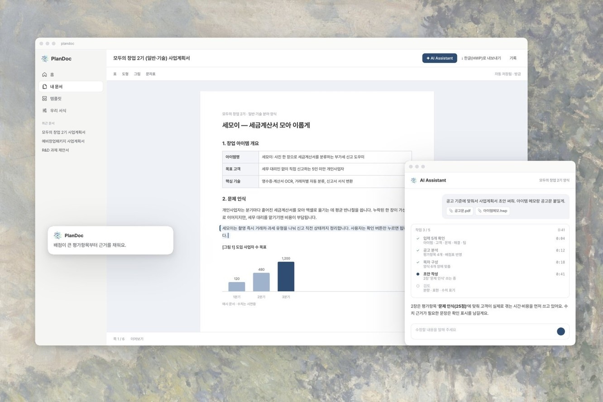
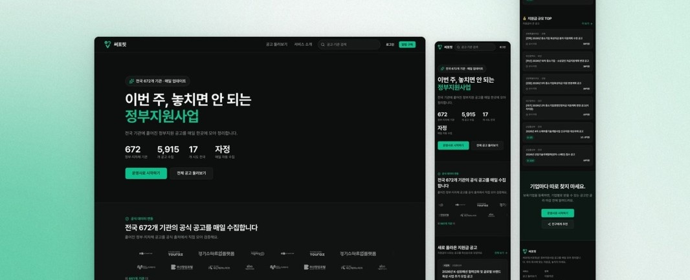

  

     

      

---

## About

AI Agent와 온톨로지로 **회사의 일하는 규칙을 구조화하고, 그 규칙대로 서류를 처리하는 제품**을 만듭니다. 기획 · 개발 · 사업화를 혼자 끝까지 해왔고, 지금은 1인 회사 지금.lab에서 SaaS 4개와 클라이언트 웹 6개를 운영합니다.

**Now building · galrae (갈래)** · Ontology-first workspace for SMB operations
- 양식(원청·기관 서식) · 규칙(체크 조건·판단 기준) · 지식(법령·지침·과거 완성본)을 경량 온톨로지 한 장으로 묶는다.
- AI는 그 지도를 따라 **규칙대로** 서류를 채우고, 근거 조문을 같이 남긴다. 회사의 AX(AI 전환) 진척은 점수로 측정한다.
- API first. 웹 콘솔 · SDK · MCP(Claude · ChatGPT · Codex)가 같은 API를 쓴다.
- Status: 기획 완료, 내부 MVP 착수 (2026-10)

---

## Experience

| 기간 | 역할 |
|---|---|
| 2024.06 ~ | **지금.lab 대표** · AI SaaS 개발 · 정부지원사업 컨설팅 |
| 2023.05 ~ 2024.06 | **For:e Product Owner** · 국가 연구과제 메인 담당 |
| 현재 | **GDG Busan Organizer** · GDG Cloud Busan · GDSC Leader |

---

## Projects

#### [PlanDoc](https://github.com/TreeJin99/plandoc-agent) · 행정문서 AI Agent · 2024 ~

회사마다 다른 규칙대로 행정문서 · 법정서식을 채우고 제출용 HWPX까지 만든다. 사업계획서 자동화로 시작해 행정문서로 피보팅했다.
- 상태머신 에이전트 · LLM 어댑터 · 양식/규칙/지식 3층 · 자동 검증 → 서명 → 내보내기 · 자체 HWPX 엔진
- **유료 운영 중** · 월 LLM API 호출 **30,000+** · 소방 점검업체 법정서식 도입

#### [써포핏 Suppofit](https://www.suppofit.com) · 정부지원사업 알림 SaaS

전국 기관 공고를 매일 수집해 LLM으로 필드를 뽑고, 기업 프로필과 매칭해 알림을 보낸다.
- 크롤러 어댑터 → LLM 필드 추출 → 매칭 → 알림 · Next.js + NestJS 모노레포 · GitHub Actions 크론
- **운영 중** · 수집 기관 **672곳** · 누적 공고 **5,915건** (2026-09 기준)

#### [Phase On](https://github.com/TreeJin99/phaseon-retrospective) · 프로젝트 관리 · 협업 웹앱 · 2024 ~ 2026 (종료)

- 런칭 3개월 만에 MAU **5,000+**. 그러나 비즈니스 모델로 잇지 못해 접었다.
- 배운 것: 사용자 수와 매출은 다른 지표다. 이후 PlanDoc을 **돈을 내는 업무**(행정문서 · 법정서식)로 피보팅했다. → [회고](https://github.com/TreeJin99/phaseon-retrospective)

#### More

| Project | What it is | Outcome |
|---|---|---|
| **[Agent Harness](https://github.com/TreeJin99/agent-harness)** | 1인 회사를 돌리는 Claude Code 멀티 에이전트 하네스. 5개 영역 · 스킬 70 · 서브에이전트 15+ · 품질 게이트 훅 | 계획서 · 웹 6개 · SaaS 4개를 1인으로 납품 |
| **B2B SaaS × 2** | IT자산 수거·파기·인증서 관리 · 에듀트립 멀티테넌트 CRM | 운영 중 |
| **Client web × 6** | 브랜드 · 기관 · 커머스 사이트 | 전부 라이브 |

대부분의 코드는 고객 계약상 비공개입니다. 아키텍처와 의사결정은 쇼케이스 레포에 정리했습니다.

---

## Skills

| | 분야 | 하는 일 |
|---|---|---|
| 01 | **AI Agent · Ontology** | 상태머신 에이전트, LLM 어댑터(공급자 교체), 프롬프트 관리, SSE 스트리밍, 양식/규칙/지식 구조화, HWPX 문서 엔진 |
| 02 | **Full-stack · Cloud** | 모노레포 웹부터 DB 보안(Supabase RLS 멀티테넌시) · 배포 자동화까지 1인 구축 |
| 03 | **Android** | MVVM · Compose 구조와 테스트까지 갖춘 네이티브 앱. Google Compose Camp 2022 강사 |

#### Claude Code, all in

1인 회사의 계획서 · 웹 · SaaS 납품을 Claude Code 하네스 하나로 돌립니다. → [Agent Harness](https://github.com/TreeJin99/agent-harness)

| | |
|---|---|
| **규모** | 5개 영역 · 스킬 70 · 서브에이전트 15+ · 자체 플러그인 5종 |
| **작성자 ≠ 평가자** | 코드 리뷰 · QA · 보안 감사는 별도 서브에이전트. 쓴 세션이 자기 결과를 채점하지 않는다 |
| **실수는 훅으로** | 같은 지적이 두 번 나오면 `bans.json` 편집 훅이나 audit 항목으로 옮겨 기계가 막는다 |
| **병렬 + 격리** | 서브에이전트는 worktree 격리, 커밋은 pathspec만. 딥서치는 Claude · Gemini · GPT 앙상블 교차 검증 |
| **MCP** | Playwright(헤드리스 검증) · Figma · Notion · Slack · Google Drive |

#### Tech stack

**AI · Agent** 
      

**Frontend** 
    

**Backend** 
    

**Infra · DevOps** 
    

**Mobile** 
   

**Test** 
   

---

## Awards · Activities

**R&D · Awards**
- '25 청년창업사관학교 15기 · '25 산학연 Collabo R&D 완료 · '26 수출바우처 (일본 계약)
- '24 창업중심대학 예비부문 **최우수** · 부산 기술창업 인큐베이팅 **최우수** · 아이디어 사업화 우수 · 시큐리티 스타트업 캠프
- '23 ALL-SET R&D 과제 수행 (동반성장디딤돌) · '23 OCR 논문 우수상 (한국멀티미디어학회)

**Teaching · Mentoring**
- 생성형 AI · 프롬프트 실무 강의 21회 (Microsoft · 한국언론진흥재단 · 동의대 · 한국해양대 · 메가시티 등, 2022.10 ~ 2026.06)
- 심사 · 멘토링: 동의과학대 창업 아이디어 경진대회 본선 심사 (2025.12) · 부산가톨릭대 테크톤 멘토링 (2025.11) · 모두의창업 선배 창업가 강연 (2026.06)
- Google Compose Camp 2022 강사 (Android 비기너 트랙)

---

<picture>
  <source media="(prefers-color-scheme: dark)" srcset="https://raw.githubusercontent.com/TreeJin99/TreeJin99/output/snake-dark.svg"/>
  
</picture>
